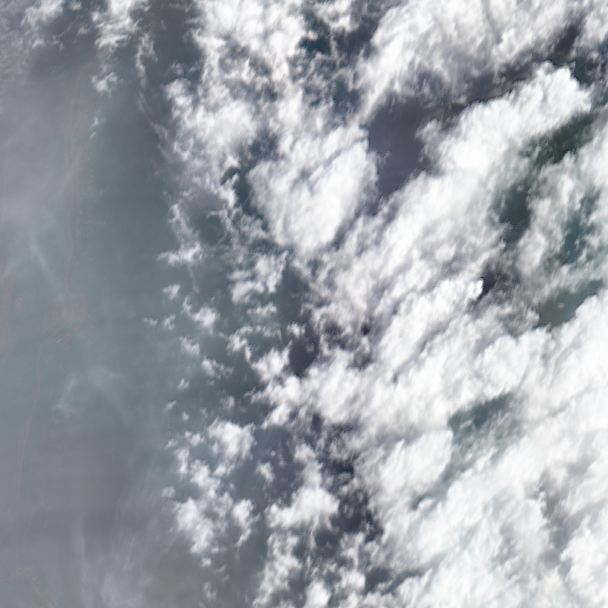
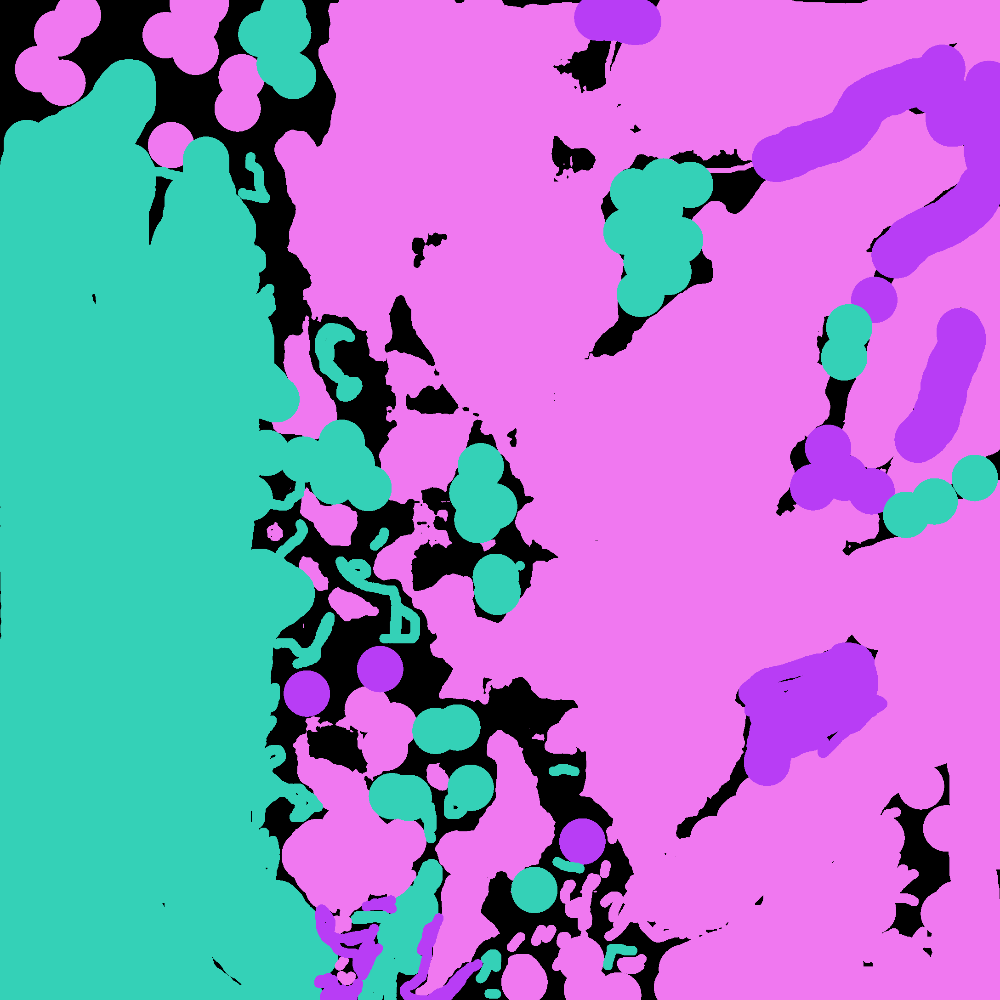
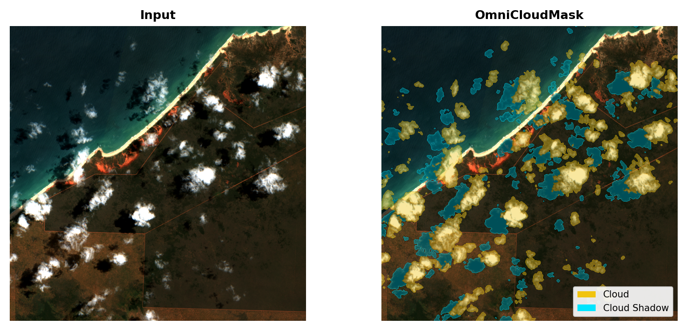

# Cloud Detection in Very-High-Resolution Optical Satellite Imagery

Classical signal processing vs. pretrained deep learning models. Ursa Space Systems 1C, Break Through Tech AI Studio, Fall 2026.

> This README is a work in progress. We'll fill in the results once the ground-truth masks are done and every method has been scored.

## Team

| Name             | GitHub               | LinkedIn | What they worked on |
|------------------|----------------------|----------|---------------------|
| Nurbu Lama       | @nurbu               | [LinkedIn](https://www.linkedin.com/in/nurbu-lama) | Researched classical cloud-detection methods (Zhang & Xiao 2014, Lin et al. 2022 and supporting papers) and is testing them on sample tiles. Doing a trial run of making starting masks with OCM and fixing them by hand. Set up the train/val/test split (`split.csv`) and dataset folders. |
| Sarrah Abdullahi | @sab2131             | [LinkedIn](https://www.linkedin.com/in/sarrah-abdullahi/) | Working out how the comparison will run: how the classical methods and OCM get scored against the ground-truth masks (IoU, precision, recall, F1, cloud-cover %). Reviewed OCM and its pipeline. |
| Nina Khilnani    | @ninakhilnani        | [LinkedIn](https://www.linkedin.com/in/nina-kh/) | Worked with Chidera on the notebook for loading, displaying and tiling the imagery. Assigned to the classical baselines (brightness/saturation threshold, dark channel, HOT-style index). Labeling training masks in CVAT. Wrote the Milestone 1 task plan and our check-in template. |
| Chidera Okafor   | @ChideraOkaforNJIT   | [LinkedIn](https://www.linkedin.com/in/chideraokafornjit/) | Labeling training masks in CVAT. Ran OCM and a SAM vs. OCM comparison in the shared Colab. Maintains the shared notebook and pushes it to GitHub. Writes up our meeting notes and weekly progress reports. |
| Pari Panchal     | @paripanchall        | [LinkedIn](https://www.linkedin.com/in/pari-panchal/) | Labeling validation and test masks in CVAT, and showed the rest of us the CVAT workflow. Assigned to the classical baselines. Wrote the project brief, workplan and milestone planning docs. |

Challenge Advisor: John Savage (Ursa Space Systems). AI Studio Coach: Julio Contreras.

## Highlights

- Comparing classical, RGB-only cloud-detection methods against a pretrained cloud-segmentation model (OmniCloudMask) on 30–50 cm Maxar imagery.
- There's no ground truth for this imagery, so we're labeling our own masks by hand.
- Every method gets scored the same way: per-pixel IoU, precision, recall and F1 for cloud vs. non-cloud, plus a look at where each one fails (thin cloud, smoke, and bright surfaces like rooftops, sand and snow).
- Final results will go here once the comparison is finished.

## Setup

We use VS Code locally and Google Colab for the shared notebook.

1. Clone the repo:
   `git clone https://github.com/Break-Through-Tech/Ursa-Space-Systems-1C-cloud-detection-in-very-high-resolution-optical-satellite-imagery.git`
2. Go into the project folder:
   `cd Ursa-Space-Systems-1C-cloud-detection-in-very-high-resolution-optical-satellite-imagery`
3. (Optional) Make a virtual environment:
   `python -m venv env`, then `source env/bin/activate` (Mac/Linux) or `.\env\Scripts\activate` (Windows)
4. Open `notebooks/ursa_space_1C.ipynb` in Google Colab and run all cells. The notebook is set up for Colab and installs its own packages (rasterio, pystac, rio-tiler, segment-anything). `requirements.txt` is still empty and will be filled in when we move the code into `src/`.

## Project overview

This project is part of Break Through Tech's AI Studio, where student teams work on a real machine-learning problem with a host company.

[Ursa Space Systems](https://ursaspace.com/) provides satellite intelligence from SAR and optical sensors for commercial and government clients. In optical imagery, clouds block the ground and throw off anything built on top of it, so finding and masking cloudy pixels is one of the first steps in almost any pipeline.

Our job is to build and compare methods that find clouds in very-high-resolution (VHR) RGB satellite images:

1. Classical signal-processing methods, which use hand-picked cues like brightness, saturation, the dark-channel prior and texture.
2. A pretrained deep-learning model, OmniCloudMask (OCM), used as-is.

Since there's no existing ground truth, the goal isn't one accuracy number. It's a clear, reproducible comparison: which approaches work best on VHR RGB imagery, where each one breaks, and why.

### Why it matters

Clouds are one of the biggest problems with commercial optical imagery. A cloudy pixel can't show a ship, a building or a flooded road, and if nobody catches it, it quietly throws off whatever is built on top of it: change detection, object counts, damage maps. Before anyone can trust an analysis, they need to know which parts of the image are actually visible.

Very-high-resolution imagery makes this harder. At 30–50 cm per pixel you can see individual cars, but most cloud-detection tools were built for satellites like Landsat and Sentinel-2, where one pixel covers 10–60 m and the sensor records extra bands like near-infrared. Commercial VHR imagery is often delivered as plain RGB, so a lot of the existing tools don't fit cleanly.

### Our thought process: why not just use a pretrained model?

The obvious move would be to take a pretrained model like OCM, run it on everything and call it done. We decided to treat this more like a research question, for a few reasons:

- A model's output isn't ground truth. OCM looks good on our tiles at first glance, but it was trained on much coarser imagery and expects an NIR band we don't have. If we only used OCM, we'd have no way to tell how often it's wrong on our data or where it fails. That's why we're hand-labeling our own masks.
- Classical methods are a real baseline. Brightness/saturation thresholds, the dark-channel prior and haze indices have been used for years. They're fast, they run on RGB only, they don't need a GPU or training data, and you can see exactly why they flag a pixel. If one of them gets close to OCM, that's a useful finding on its own.
- Knowing why something fails matters as much as the score. Each approach relies on different cues, so they should break in different places. Thin cloud, wildfire smoke and bright rooftops or sand are where we expect the differences to show. Seeing those failures side by side tells Ursa which tool to trust in which situation.
- It shows whether the deep-learning model is worth it. Pretrained models are heavier to run and harder to explain. A fair comparison on the same tiles, scored against the same masks, shows how much OCM actually adds on top of the simpler methods.

So instead of just picking a model, we're asking: on very-high-resolution RGB imagery, how do classical signal-processing methods compare to a pretrained deep-learning model, and when should you use which? The final notebook and write-up are meant to work as an internal reference for Ursa, not only as a one-time result.

## Data

Source: the [Maxar / Vantor Open Data Program](https://radiantearth.github.io/stac-browser/#/external/maxar-opendata.s3.amazonaws.com/events/catalog.json), specifically the NWT-Canada-Aug-23 wildfire event.

The source scenes are cloud-optimized GeoTIFFs (the RGB `visual` product) at about 30–50 cm resolution. We cut each scene into quarter tiles and saved them as JPG for labeling and evaluation.

Our working set is 214 tiles from Kelowna and Yellowknife, across four satellite passes and three dates (Aug 8, 15 and 21, 2023). We picked scenes with more cloud on purpose.

| Split      | Tiles |
|------------|-------|
| Train      | 106   |
| Validation | 53    |
| Test       | 55    |

We split by area block, so the same patch of ground never shows up in more than one split. Otherwise nearly identical neighboring tiles could end up in both train and test.

What makes this data tricky:
- Smoke vs. cloud. These are wildfire scenes, so there's smoke everywhere and it can look a lot like thin cloud. We're only detecting cloud, so the methods shouldn't flag smoke.
- Bright ground. Rooftops, sand and bare ground can be as bright as cloud.
- Thin, see-through cloud with soft edges.
- Resolution. Most published cloud-detection methods were built for 10–60 m imagery (Landsat, Sentinel-2), not 30–50 cm.

## Ground-truth masks

There's no ground truth for this imagery, so we're making our own.

- Hand labeling in CVAT. Each tile gets labeled pixel by pixel as `clear`, `cloud` or `uncertain`. CVAT's assisted segmentation gives a first pass, then we fix it with the brush tool.
  - Pari: validation and test tiles
  - Chidera and Nina: training tiles
- OCM-assisted masks (trial run). Nurbu is testing whether it works to start from OCM's masks and correct them by hand. If we trained on raw OCM output, a model would just learn to copy OCM, so the corrections are what would make these masks useful.
- Keeping the test set independent. Scoring OCM against raw OCM masks would only tell us how much OCM agrees with itself. The test masks are checked by hand so OCM isn't graded against a lightly edited copy of its own output.
- Still to decide: how to score `uncertain` and smoke pixels. Most likely we'll leave them out of the metrics.

### Example mask

One of the first training masks, labeled in CVAT by Chidera (Kelowna, 2023-08-21, tile `013331213213`, bottom-right quarter):

<table>
  <tr>
    <th>Input tile (RGB)</th>
    <th>Hand-labeled mask</th>
  </tr>
  <tr>
    <td></td>
    <td></td>
  </tr>
</table>

| Color  | Label       | RGB             |
|--------|-------------|-----------------|
| Pink   | `cloud`     | (240, 120, 240) |
| Teal   | `clear`     | (52, 209, 183)  |
| Purple | `uncertain` | (184, 61, 245)  |
| Black  | unlabeled   | (0, 0, 0)       |

This tile is a good example of why labeling is hard. The thick clouds on the right are obviously cloud. The hazy left side is labeled `clear`, and the edges where thin cloud fades into haze are `uncertain`. The black gaps haven't been labeled yet, so this mask is still being worked on.

## Methods

### Classical methods (RGB only)

These are the two we're focusing on, based on our literature review:

| Method | How it works | Why it might fit | Main risk |
|---|---|---|---|
| Zhang & Xiao (2014) | Builds a significance map and a rough mask, removes non-cloud areas with a multiscale detail map, then uses guided feathering for soft edges | Made for RGB aerial photos, which is closest to our imagery | Fine detail may be harder to separate at 30–50 cm |
| Lin et al. (2022) | Uses the dark-channel prior to estimate how much light gets through, corrects that with spectral features, then removes bright-surface false positives | Aimed at high-resolution imagery and good at thin cloud | Built for Gaofen-2 multispectral imagery, so parts of it (water and brightness masks) may need NIR |

We're also implementing some simpler baselines: brightness/saturation thresholding, a dark-channel method and a HOT-style (haze-optimized transform) index.

A few things we picked up from the supporting papers:
- Otsu thresholding fails when the histogram only has one peak, so you need a minimum threshold (Ramos et al., 2016).
- Accuracy alone can be misleading. One reported scene had 0.82 accuracy but only 0.09 precision. That's why we report precision, recall, F1 and IoU.
- HOT gets noisy at high resolution and needs median filtering (Chang & Chen, 2011).

### Pretrained model: OmniCloudMask (OCM)

Our Challenge Advisor pointed us to OCM, and we run it zero-shot on the same tiles. OCM was designed for roughly 10–50 m imagery, so part of what we're testing is how well it holds up at 30–50 cm.

OCM is an open-source model (MIT license) that labels each pixel as clear, thick cloud, thin cloud or cloud shadow. It was trained to work across different satellites and has been tested on Sentinel-2, Landsat 8, PlanetScope and Maxar. For our comparison we merge thick and thin cloud into one `cloud` class.

  
   
  <em>Example output from the OCM developers (not our imagery). Source: <a href="https://github.com/DPIRD-DMA/OmniCloudMask">OmniCloudMask on GitHub</a>.</em>

More on OCM:
- Code and docs: [github.com/DPIRD-DMA/OmniCloudMask](https://github.com/DPIRD-DMA/OmniCloudMask)
- Python package: [`omnicloudmask` on PyPI](https://pypi.org/project/omnicloudmask/)
- Paper: Wright et al. (2025), *Remote Sensing of Environment* 322. [doi:10.1016/j.rse.2025.114694](https://doi.org/10.1016/j.rse.2025.114694)

One catch: OCM expects Red, Green and near-infrared (NIR) bands. Our tiles are RGB only, so right now our OCM notebook cell passes Red and Green and fills the NIR channel with zeros. That could make OCM look worse on our imagery than it really is. See stretch goal 2.

### How we're comparing them

Every method is scored against the same hand-labeled masks using:
- per-pixel IoU, precision, recall and F1 for cloud vs. non-cloud
- cloud-cover % per tile, compared with the ground-truth cloud-cover %
- a look at the failure cases: thin cloud, smoke and bright surfaces

Thresholds and parameters are only tuned on validation tiles, never on test tiles.

## Stretch goals

The challenge lists five stretch goals. We're working on 2, 3 and 4.

### 2. Adding the NIR band

NIR helps tell cloud apart from bright ground and water, and some methods (OCM, and maybe Lin et al.) expect it. We can't make NIR ourselves, so this depends on whether Maxar already has a multispectral version of our scenes.

- Our tiles come from the 3-band RGB `visual` product, so there's no NIR right now.
- We're checking whether a multispectral file exists for the NWT-Canada-Aug-23 scenes.
- If it does, we'll rerun the classical methods and OCM with real NIR and see how much it helps, especially with bright surfaces and smoke.
- If it doesn't, we'll note it as a limitation and stay RGB-only.

### 3. Fine-tuning a small segmentation model

- Fine-tune a small model (a compact U-Net, or SAM on around 8 tiles like our coach suggested) on our hand-corrected training masks.
- Use augmentation (rotations, flips, brightness and saturation changes) since we don't have many labeled tiles.
- Score it alongside the classical methods and zero-shot OCM, on the same validation and test masks.
- The question we want to answer: does training on corrected masks let a model beat OCM, or does it just end up copying it?

### 4. Cloud-cover estimator and "usable imagery" filter

- Turn each method's mask into a cloud-cover % per tile and compare it with the ground-truth %.
- Add a simple cutoff that marks each tile as usable or not (for example, under a certain cloud-cover %).
- This builds on the cloud-cover % we're already computing for the comparison.

## Planning and progress

We plan in monthly milestones that follow the challenge timeline, and break each one into tasks tracked as GitHub [issues](https://github.com/Break-Through-Tech/Ursa-Space-Systems-1C-cloud-detection-in-very-high-resolution-optical-satellite-imagery/issues).

| Milestone | Tasks |
|---|---|
| September: foundations and data | Pick and download imagery, put together a high-cloud working set, build a notebook to load/display/tile the imagery, write a data characterization guide |
| October: classical baselines | Image selection, implement three classical baselines, build a labeled evaluation set, evaluate and compare the baselines, finish the data guide |
| November: pretrained models and comparison | Finish the ground-truth masks, build the evaluation pipeline, compare OCM and the classical methods head to head, final presentation (full task list below) |

### November tasks (Milestone 3)

This is our November plan as of early November. Statuses will change as we go.

| # | Task | Owner | Status | Target date |
|---|---|---|---|---|
| 1 | Finish hand-labeling the images picked in October, and put the hand-drawn masks and original images in one folder for the evaluation pipeline | Pari | In progress | Nov 12 |
| 2 | Trial run: make starting masks with OCM and fix them by hand, to see how well that works | Nurbu | In progress | |
| 3 | Finish the evaluation pipeline comparing OCM against the hand-labeled masks (precision, recall, IoU) | Sarrah | In progress | |
| 4 | Update this README and make sure everyone has added something to the GitHub repo | Nurbu | To do | |
| 5 | Make and rehearse the final presentation | Everyone | To do | Nov 25 |
| 6 | Add an "ensemble consensus" cell to the Colab notebook | Chidera | To do | Nov 11 |
| 7 | If there's time, try building a one-page interactive web app for the repo | Nina, Chidera | To do | Nov 30 |
| 8 | Work with everyone on the presentation slides | Sarrah | In progress | |
| 9 | Research the classical methods currently in our Drive | Nurbu | To do | Nov 15 |
| | Presentation: "Engineering constraints and decisions" slide, covering the preprocessing, the constraints we ran into in Colab and research, and the workarounds | Nina, Chidera | | |

Chidera writes up each meeting and posts it in [`progressReport/`](progressReport/) (and as GitHub issues so everyone can check them off). Here's how the plan changed week to week:

| Week | Notes | What happened |
|---|---|---|
| Week 7 (9/29) | [Week7Submeeting.md](progressReport/Week7Submeeting.md) | Small Zoom call to pin down the actual project goal and try some preprocessing. Talked about augmenting our first 25 images (rotations, flips, brightness) and about each of us owning part of the train/val/test labeling. |
| Week 9 (10/14) | [Week9.md](progressReport/Week9.md) | Lab check-in with our coach and CA. Expanded the dataset from one section (about 25 images, risky for overfitting) to all four, split 2 train / 1 val / 1 test and tracked in a CSV. Coach suggested fine-tuning SAM on a small subset and pushing notebooks more often. The CA explained that masks have to be chipped the same way as the images. |
| Week 9 (10/18) | [Week9Submeeting.md](progressReport/Week9Submeeting.md) | Clarified that this is semantic segmentation of cloud only, with smoke ignored. Decided to hand-correct OCM masks instead of trusting them as-is, and to use the corrected masks for validation and test. Flagged that the tiles should be GeoTIFF instead of JPEG. |
| Week 10 (10/21) | [Week10.md](progressReport/Week10.md) | Lab on agentic coding (explore, plan, build, check), plus a mentor breakout on collaboration and planning. |
| Week 11 (10/28) | [Week11.md](progressReport/Week11.md) | Split up the CVAT labeling: about 2–3 tiles per split, Pari on val/test, Nina and Chidera on train. Planned to add precision/recall for SAM vs. OCM to the comparison. The CA recommended packaging the code into `src/` with a `cli.py`. |

## Results

Still in progress. We'll add results once the ground-truth masks are finished and every method has been scored.

## Next steps

- Finish the hand-labeled masks for train, validation and test.
- Decide how to score `uncertain` and smoke pixels.
- Run the classical methods and OCM on every labeled tile and compute the metrics.
- Find out whether NIR is available (stretch goal 2).
- Move the notebook code into `src/` (preprocessing, evaluation, inference) with a `cli.py`, like our CA recommended.

Known limitations so far:
- The hand-labeled evaluation set is small.
- The tiles are JPG right now, and compression could hurt the fine-detail and dark-channel cues.
- Most published methods and models were built for much coarser imagery.
- OCM is currently running without a real NIR band.

## License

To be decided with our Challenge Advisor.

## References

- Zhang, Q. & Xiao, C. (2014). Cloud detection of RGB color aerial photographs by progressive refinement scheme. *IEEE Transactions on Geoscience and Remote Sensing*, 52(11), 7264–7275. [DOI](https://doi.org/10.1109/TGRS.2014.2310240)
- Lin et al. (2022). Cloud detection of Gaofen-2 multi-spectral imagery based on the modified radiation transmittance map. *Remote Sensing*, 14(17), 4374. [DOI](https://doi.org/10.3390/rs14174374)
- Ramos et al. (2016). ACRS 2016. [PDF](https://a-a-r-s.org/proceeding/ACRS2016/ACRS%202016%20Poster%20Papers/Day4-Oct20/Ab%200502.pdf)
- Seo et al. (2023). ISPRS Archives. [Article](https://isprs-archives.copernicus.org/articles/XLVIII-1-W2-2023/1537/2023/)
- Chang & Chen (2011). ACRS 2011. [PDF](https://a-a-r-s.org/proceeding/ACRS2011/Session/Paper/P_180_9-1-09.pdf)
- Wright, N., Duncan, J. M. A., Callow, J. N., Thompson, S. E. & George, R. J. (2025). Training sensor-agnostic deep learning models for remote sensing: Achieving state-of-the-art cloud and cloud shadow identification with OmniCloudMask. *Remote Sensing of Environment*, 322. [DOI](https://doi.org/10.1016/j.rse.2025.114694) · [Code](https://github.com/DPIRD-DMA/OmniCloudMask)
- [Maxar / Vantor Open Data Program](https://radiantearth.github.io/stac-browser/#/external/maxar-opendata.s3.amazonaws.com/events/catalog.json)

## Acknowledgements

Thanks to our Challenge Advisor John Savage and Ursa Space Systems for the project and for pointing us to OmniCloudMask, to our AI Studio Coach Julio Contreras for guidance all semester, and to the Break Through Tech team.
