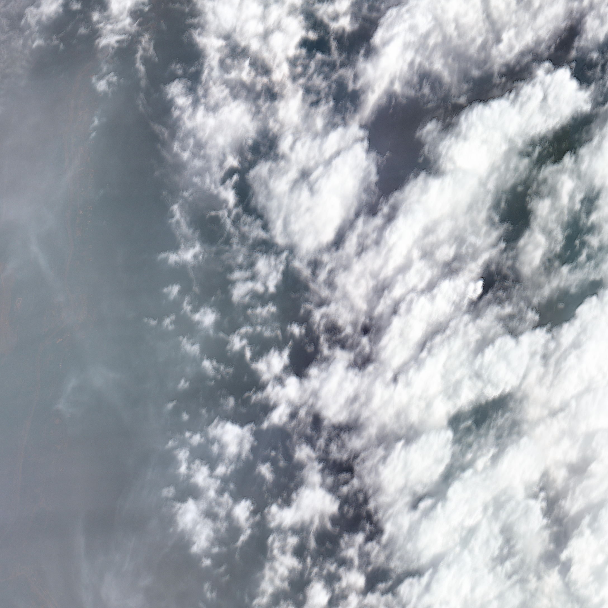
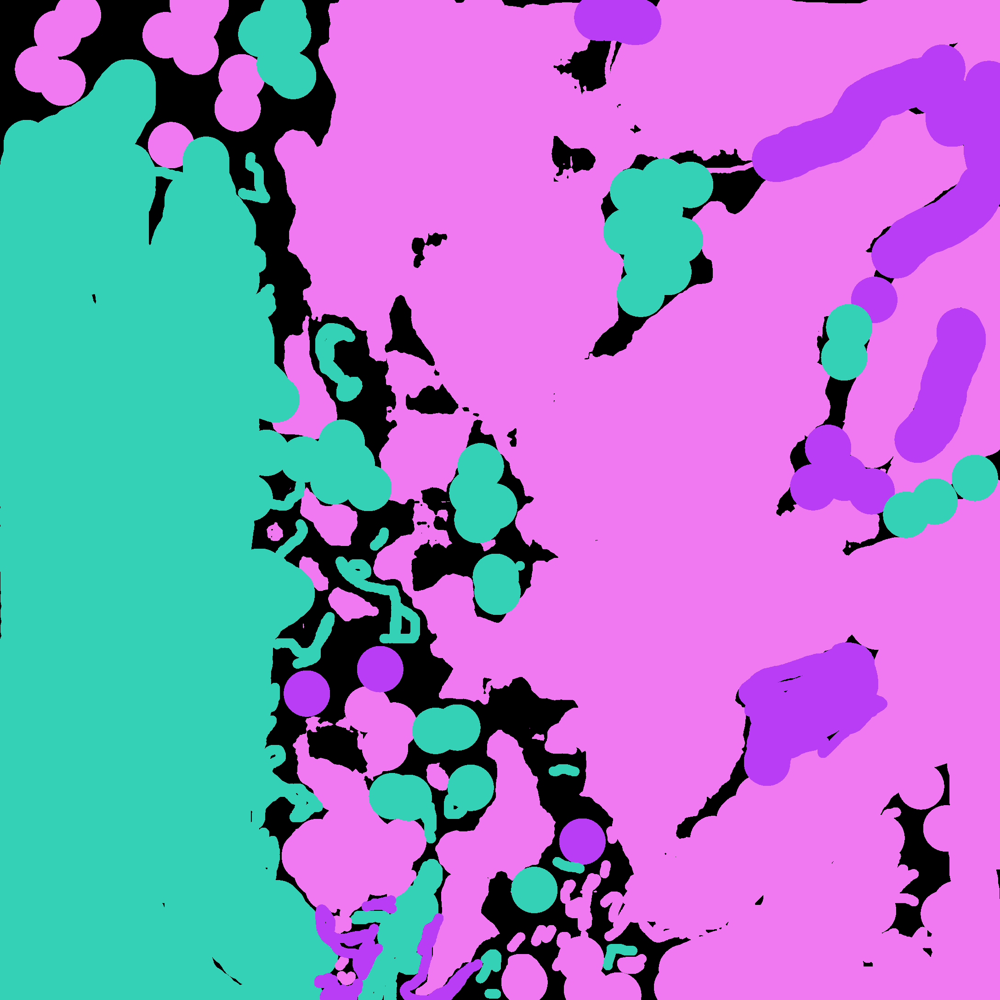
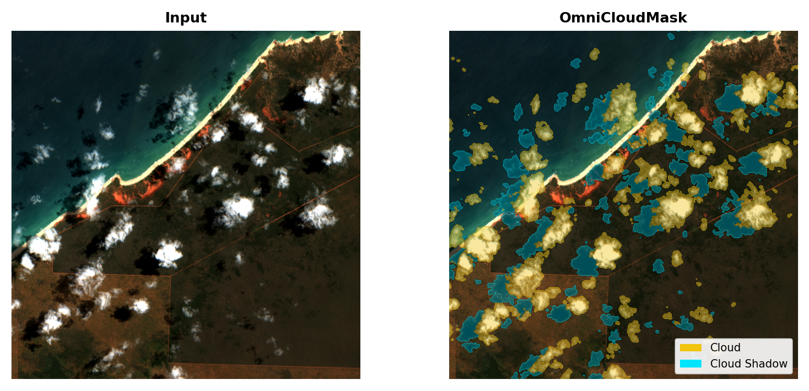

# Cloud Detection in Very-High-Resolution Optical Satellite Imagery

Classical signal processing vs. pretrained deep learning models. Ursa Space Systems 1C, Break Through Tech AI Studio, Fall 2026.

> This README is a work in progress. We'll fill in the results once the ground-truth masks are done and every method has been scored.

## Team

| Name             | GitHub               | LinkedIn | What they worked on |
|------------------|----------------------|----------|---------------------|
| Nurbu Lama       | @nurbu               | [LinkedIn](https://www.linkedin.com/in/nurbu-lama) | Researched classical cloud-detection methods. Built the OCM-assisted ground-truth pipeline: the crop/split notebook (`cloud_benchmark_setup.ipynb`), the CVAT scripts in `scripts/`, and hand-fixing OCM's draft masks in CVAT. Built the benchmark notebook (`cloud_baselines_benchmark.ipynb`) that scores four classical methods and OCM. Wrote this README. |
| Sarrah Abdullahi | @sab2131             | [LinkedIn](https://www.linkedin.com/in/sarrah-abdullahi/) | Working out how the comparison will run: how the classical methods and OCM get scored against the ground-truth masks (IoU, precision, recall, F1, cloud-cover %). Reviewed OCM and its pipeline. |
| Nina Khilnani    | @ninakhilnani        | [LinkedIn](https://www.linkedin.com/in/nina-kh/) | Worked with Chidera on the notebook for loading, displaying and tiling the imagery. Assigned to the classical baselines (brightness/saturation threshold, dark channel, HOT-style index). Labeling training masks in CVAT. Wrote the Milestone 1 task plan and our check-in template. |
| Chidera Okafor   | @ChideraOkaforNJIT   | [LinkedIn](https://www.linkedin.com/in/chideraokafornjit/) | Labeling training masks in CVAT. Ran OCM and a SAM vs. OCM comparison in the shared Colab. Maintains the shared notebook and pushes it to GitHub. Writes up our meeting notes and weekly progress reports. |
| Pari Panchal     | @paripanchall        | [LinkedIn](https://www.linkedin.com/in/pari-panchal/) | Labeling validation and test masks in CVAT, and showed the rest of us the CVAT workflow. Assigned to the classical baselines. Wrote the project brief, workplan and milestone planning docs. |

Challenge Advisor: John Savage (Ursa Space Systems). AI Studio Coach: Julio Contreras.

## Highlights

- Comparing classical, RGB-only cloud-detection methods against a pretrained cloud-segmentation model (OmniCloudMask) on 30–50 cm Maxar imagery.
- There's no ground truth for this imagery, so we're labeling our own masks by hand.
- Every method gets scored the same way: per-pixel IoU, precision, recall and F1 for cloud vs. non-cloud, plus a look at where each one fails (thin cloud, smoke, and bright surfaces like rooftops, sand and snow).
- Final results will go here once the comparison is finished.

## Setup

We use VS Code locally and Google Colab for the shared notebook.

1. Clone the repo:
   `git clone https://github.com/Break-Through-Tech/Ursa-Space-Systems-1C-cloud-detection-in-very-high-resolution-optical-satellite-imagery.git`
2. Go into the project folder:
   `cd Ursa-Space-Systems-1C-cloud-detection-in-very-high-resolution-optical-satellite-imagery`
3. (Optional) Make a virtual environment:
   `python -m venv env`, then `source env/bin/activate` (Mac/Linux) or `.\env\Scripts\activate` (Windows)
4. Install the packages for the scripts and the benchmark notebook:
   `pip install -r requirements.txt`
5. Open `notebooks/ursa_space_1C.ipynb` in Google Colab and run all cells. The notebook is set up for Colab and installs its own packages (rasterio, pystac, rio-tiler, segment-anything).
6. To run `notebooks/cloud_benchmark_setup.ipynb` on your own PC, it looks for `My Drive/ursa space 1C data` through Google Drive for desktop. If your data is somewhere else, set the `URSA_PROJECT_DIR` environment variable or fill in `LOCAL_PROJECT_DIR` in the Settings cell.

## Running the benchmark

[](https://colab.research.google.com/github/Break-Through-Tech/Ursa-Space-Systems-1C-cloud-detection-in-very-high-resolution-optical-satellite-imagery/blob/main/notebooks/cloud_baselines_benchmark.ipynb)

`notebooks/cloud_baselines_benchmark.ipynb` scores the classical detectors (brightness + whiteness, dark-channel prior, HOT, Otsu) and OmniCloudMask against our hand-checked masks. Right now it scores Nurbu's OCM-assisted masks. It will also be run separately on Pari's hand-only masks so the two can be compared (see [Keeping the test set fair](#keeping-the-test-set-fair)). The data isn't in this repo. It's on Google Drive in `ursaspace1C_data/crops`, and the notebook finds it on its own.

**One-time setup:** in Google Drive, go to *Shared with me*, right-click `ursaspace1C_data`, then choose *Organize > Add shortcut > My Drive*.

**To run:** open the notebook in Colab with the badge above, choose *Runtime > Run all*, and approve Drive access when asked.

**Results** are saved to `ursaspace1C_data/benchmark_results`. If you only have view access to the shared folder, set `RESULTS_DIR = "/content/results"` in the settings cell so the results go to the Colab session instead. Files there are deleted when the session ends, so download anything you want to keep.

## Project overview

This project is part of Break Through Tech's AI Studio, where student teams work on a real machine-learning problem with a host company.

[Ursa Space Systems](https://ursaspace.com/) provides satellite intelligence from SAR and optical sensors for commercial and government clients. In optical imagery, clouds block the ground and throw off anything built on top of it, so finding and masking cloudy pixels is one of the first steps in almost any pipeline.

Our job is to build and compare methods that find clouds in very-high-resolution (VHR) RGB satellite images:

1. Classical signal-processing methods, which use hand-picked cues like brightness, saturation, the dark-channel prior and texture.
2. A pretrained deep-learning model, OmniCloudMask (OCM), used as-is.

Since there's no existing ground truth, the goal isn't one accuracy number. It's a clear, reproducible comparison: which approaches work best on VHR RGB imagery, where each one breaks, and why.

### Why it matters

Clouds are one of the biggest problems with commercial optical imagery. A cloudy pixel can't show a ship, a building or a flooded road, and if nobody catches it, it quietly throws off whatever is built on top of it: change detection, object counts, damage maps. Before anyone can trust an analysis, they need to know which parts of the image are actually visible.

Very-high-resolution imagery makes this harder. At 30–50 cm per pixel you can see individual cars, but most cloud-detection tools were built for satellites like Landsat and Sentinel-2, where one pixel covers 10–60 m and the sensor records extra bands like near-infrared. Commercial VHR imagery is often delivered as plain RGB, so a lot of the existing tools don't fit cleanly.

### Our thought process: why not just use a pretrained model?

The obvious move would be to take a pretrained model like OCM, run it on everything and call it done. We decided to treat this more like a research question, for a few reasons:

- A model's output isn't ground truth. OCM looks good on our tiles at first glance, but it was trained on much coarser imagery and expects an NIR band we don't have. If we only used OCM, we'd have no way to tell how often it's wrong on our data or where it fails. That's why we're hand-labeling our own masks.
- Classical methods are a real baseline. Brightness/saturation thresholds, the dark-channel prior and haze indices have been used for years. They're fast, they run on RGB only, they don't need a GPU or training data, and you can see exactly why they flag a pixel. If one of them gets close to OCM, that's a useful finding on its own.
- Knowing why something fails matters as much as the score. Each approach relies on different cues, so they should break in different places. Thin cloud, wildfire smoke and bright rooftops or sand are where we expect the differences to show. Seeing those failures side by side tells Ursa which tool to trust in which situation.
- It shows whether the deep-learning model is worth it. Pretrained models are heavier to run and harder to explain. A fair comparison on the same tiles, scored against the same masks, shows how much OCM actually adds on top of the simpler methods.

So instead of just picking a model, we're asking: on very-high-resolution RGB imagery, how do classical signal-processing methods compare to a pretrained deep-learning model, and when should you use which? The final notebook and write-up are meant to work as an internal reference for Ursa, not only as a one-time result.

## Data

Source: the [Maxar / Vantor Open Data Program](https://radiantearth.github.io/stac-browser/#/external/maxar-opendata.s3.amazonaws.com/events/catalog.json), specifically the NWT-Canada-Aug-23 wildfire event.

The source scenes are cloud-optimized GeoTIFFs (the RGB `visual` product) at about 30–50 cm resolution. We cut each scene into quarter tiles and saved them as JPG for labeling and evaluation.

Our working set is 214 tiles from Kelowna and Yellowknife, across four satellite passes and three dates (Aug 8, 15 and 21, 2023). We picked scenes with more cloud on purpose.

| Split      | Tiles |
|------------|-------|
| Train      | 106   |
| Validation | 53    |
| Test       | 55    |

We split by area block, so the same patch of ground never shows up in more than one split. Otherwise nearly identical neighboring tiles could end up in both train and test.

What makes this data tricky:
- Smoke vs. cloud. These are wildfire scenes, so there's smoke everywhere and it can look a lot like thin cloud. We're only detecting cloud, so the methods shouldn't flag smoke.
- Bright ground. Rooftops, sand and bare ground can be as bright as cloud.
- Thin, see-through cloud with soft edges.
- Resolution. Most published cloud-detection methods were built for 10–60 m imagery (Landsat, Sentinel-2), not 30–50 cm.

## Ground-truth masks

There's no ground truth for this imagery, so we're making our own. We label in CVAT, using two different approaches.

### Approach 1: Labeling by hand from scratch

- Each tile is labeled pixel by pixel in CVAT as `clear`, `cloud` or `uncertain`, starting from a blank mask. (The OCM-assisted masks below use `cloud`, `smoke` and `unsure` instead, so smoke can be scored separately.)
  - **Pari:** validation and test tiles. Pari labeled entirely by hand from the start, with no model draft underneath. Because of this, those masks are fully independent of every method we're scoring.
  - **Chidera and Nina:** training tiles.

### Approach 2: OCM-assisted masks (Nurbu)

Nurbu takes a different route. OmniCloudMask (OCM) makes the first draft of each mask, and every draft is then corrected by hand in CVAT. Starting from a draft saves time on the easy areas, like big, obvious clouds and clear ground, so most of the effort goes into the hard parts: thin cloud edges, smoke and bright ground.

The hand corrections are what make these masks worth having. If we trained or scored on raw OCM output, a model would just learn to copy OCM, and OCM would only be graded on how much it agrees with itself. So nothing is used until it has been checked and fixed by hand.

#### Fixing masks with a drawing tablet

Nurbu does the hand fixes with a **One by Wacom** pen tablet instead of a mouse. Cloud edges are soft and irregular, and the pen makes it much easier to trace them closely with CVAT's brush and polygon tools. It also helps with painting the thin gaps between clouds and cleaning up small speckles OCM leaves behind.

#### The scripts, step by step

The pipeline runs on a **local CVAT** (self-hosted on Nurbu's own machine instead of app.cvat.ai). This keeps the full-resolution crops and their annotations on the same machine as the data.

| Step | File | What it does |
|---|---|---|
| 1 | `notebooks/cloud_benchmark_setup.ipynb` | Sorts the Maxar images into `test`, `val` and `set_aside` (a strip of Kelowna kept out so the same clouds don't land in both `val` and `test`). Cuts 2048×2048 crops, runs OCM on each one, and saves `image.tif` plus OCM's draft `mask_ocm_assisted.tif` in `clean_dataset/ocm_assisted/<group>/<crop>/`. Keeps a `label_tracker.csv` of every crop and whether it's been fixed. (Its Steps 4–5 hold an earlier draft of the scoring. The comparison itself is done in `cloud_baselines_benchmark.ipynb`.) |
| 2 | `scripts/prep_for_cvat.py` | Gets the OCM drafts ready for CVAT. Writes a PNG copy of each crop (`image.png`), renamed copies to drag into one CVAT task, a `cvat_masks.zip` with the drafts as CVAT annotations, and a `manifest.csv` linking each upload name back to its crop folder. `--groups` splits the crops into separate upload sets (for example, by priority). |
| 3 | CVAT (by hand) | Load the drafts and fix them with the tablet. |
| 4a | `scripts/apply_cvat_masks.py` | Reads a *Segmentation mask 1.1* export and writes `mask_gt.png` into each crop folder. It checks the size against `image.tif` (or `image.png` if the TIFF isn't there). |
| 4b | `scripts/cvat_xml_to_masks.py` | Does the same from a *CVAT for images 1.1* export. Use this one when shapes were drawn with the polyline tool, because CVAT's mask export skips polylines (a line has no area). It closes and fills each polyline. Full-image shapes are drawn first as the base layer and snapped to the image edges. `--preview DIR` writes side-by-side previews for spot checks. |

How OCM's classes become CVAT labels in step 2:

| OCM draft value | CVAT label |
|---|---|
| 1 thick cloud, 2 thin cloud | `cloud` (our rule: thin cloud counts as cloud) |
| 4 smoke | `smoke` (kept separate: smoke is not cloud) |
| 5 unsure | `unsure` |
| 0 clear, 3 shadow | background |

#### Running it

These steps take the crops from the setup notebook all the way to the folder layout that the benchmark notebook reads (`ursaspace1C_data/`):

```
clean_dataset/                      <- written by cloud_benchmark_setup.ipynb
  ocm_assisted/<test|val>/<crop>/   image.tif, mask_ocm_assisted.tif
  _ocm_predictions/<crop>.tif       OCM's untouched answer, used to score OCM
ursaspace1C_data/                   <- read by cloud_baselines_benchmark.ipynb
  crops/<test|val>/<crop>/          image.png, mask_gt.png
  _ocm_predictions/<crop>.tif       copied from clean_dataset/
  benchmark_results/                written by the benchmark
```

1. **Make the crops:** run `notebooks/cloud_benchmark_setup.ipynb` through Step 2.
2. **Prep for CVAT:** point `--crops` at the benchmark's `crops` folder, so `image.png` lands where the benchmark looks for it:
   `python scripts/prep_for_cvat.py clean_dataset/ocm_assisted cvat_upload --crops ursaspace1C_data/crops [--groups groups.csv]`
3. **Fix in CVAT:** create a project with labels named exactly `cloud`, `smoke` and `unsure`. Create a task with the images from `cvat_upload/images`, then load `cvat_upload/cvat_masks.zip` through *Actions > Upload annotations > Segmentation mask 1.1*, and fix every mask by hand.
4. **Bring the masks back:** export the task and run one of these (if you used `--groups`, run it once per group, with that group's export and `manifest.csv`):
   - `python scripts/apply_cvat_masks.py <export.zip> ursaspace1C_data/crops cvat_upload/manifest.csv` for a *Segmentation mask 1.1* export
   - `python scripts/cvat_xml_to_masks.py <export.zip|annotations.xml> ursaspace1C_data/crops cvat_upload/manifest.csv [--preview previews/]` for a *CVAT for images 1.1* export
5. **Copy OCM's predictions:** copy `clean_dataset/_ocm_predictions/` to `ursaspace1C_data/_ocm_predictions/`. Without it, the benchmark skips OCM, or you can set `OCM_MODE = "live"` to rerun OCM on a GPU instead.
6. Mark the crop as `fixed` in `label_tracker.csv`.
7. **Score:** run `notebooks/cloud_baselines_benchmark.ipynb` (see [Running the benchmark](#running-the-benchmark)). It uses every crop that has both `image.png` and `mask_gt.png`. Off Colab, set the `CROPS_DIR` environment variable to your `ursaspace1C_data/crops` folder.

Each crop folder ends up with `mask_gt.png`, on the same grid as `image.tif`:

| Value | Meaning |
|---|---|
| 0 | Not cloud |
| 255 | Cloud |
| 64 | Smoke |
| 128 | Unsure |

For training and scoring, cloud = `mask == 255`.

### Keeping the test set fair

Right now the benchmark scores against Nurbu's OCM-assisted masks. Scoring OCM against masks that started as OCM drafts could favor OCM, even after every mask has been fixed by hand. To check this, we'll run the benchmark **separately on Nurbu's OCM-assisted masks and on Pari's hand-only masks**, then compare:
- the scores each method gets on the two mask sets, especially OCM's
- the masks themselves, to see how much starting from an OCM draft changes the final labels

The benchmark also reports how many pixels in each OCM-assisted mask differ from OCM's original draft (`gt_vs_ocm_changes.csv`).

`unsure` and smoke pixels are left out of the main scores. Smoke gets its own check: the share of smoke pixels each method wrongly calls cloud.

### Example mask

One of the first training masks, labeled in CVAT by Chidera (Kelowna, 2023-08-21, tile `013331213213`, bottom-right quarter):

<table>
  <tr>
    <th>Input tile (RGB)</th>
    <th>Hand-labeled mask</th>
  </tr>
  <tr>
    <td></td>
    <td></td>
  </tr>
</table>

| Color  | Label       | RGB             |
|--------|-------------|-----------------|
| Pink   | `cloud`     | (240, 120, 240) |
| Teal   | `clear`     | (52, 209, 183)  |
| Purple | `uncertain` | (184, 61, 245)  |
| Black  | unlabeled   | (0, 0, 0)       |

This tile is a good example of why labeling is hard. The thick clouds on the right are obviously cloud. The hazy left side is labeled `clear`, and the edges where thin cloud fades into haze are `uncertain`. The black gaps haven't been labeled yet, so this mask is still being worked on.

## Methods

### Classical methods (RGB only)

The benchmark runs four classical methods. They all work on RGB only and need no training data. The thresholds for brightness + whiteness, dark channel and HOT are picked on the validation crops. Otsu needs no tuning.

| Method | Idea | Source |
|---|---|---|
| Brightness + whiteness | A pixel is cloud if it's bright **and** colorless (R, G and B about equal) | Zhu & Woodcock (2012), the Fmask paper. Whiteness test from Gómez-Chova et al. (2007) |
| Dark-channel prior | Clear ground almost always has something dark nearby (a shadow, a tree, water). If even the darkest pixel in a small area is bright, it's cloud or haze | He, Sun & Tang (2009) |
| HOT (haze-optimized transform) | Haze and cloud raise blue more than red, so it measures how far each pixel sits from the normal blue-vs-red relationship of clear ground (fit on the clear pixels in the validation masks) | Zhang, Guindon & Cihlar (2002) |
| Otsu threshold | Picks a brightness cutoff automatically for each image | Otsu (1979) |

We also reviewed two more complex RGB methods during the literature review. They shaped how we thought about the problem, but they aren't implemented in the benchmark:

| Method | How it works | Why it might fit | Main risk |
|---|---|---|---|
| Zhang & Xiao (2014) | Builds a significance map and a rough mask, removes non-cloud areas with a multiscale detail map, then uses guided feathering for soft edges | Made for RGB aerial photos, which is closest to our imagery | Fine detail may be harder to separate at 30–50 cm |
| Lin et al. (2022) | Uses the dark-channel prior to estimate how much light gets through, corrects that with spectral features, then removes bright-surface false positives | Aimed at high-resolution imagery and good at thin cloud | Built for Gaofen-2 multispectral imagery, so parts of it (water and brightness masks) may need NIR |

A few things we picked up from the supporting papers:
- Otsu thresholding fails when the histogram only has one peak, so you need a minimum threshold (Ramos et al., 2016).
- Accuracy alone can be misleading. One reported scene had 0.82 accuracy but only 0.09 precision. That's why we report precision, recall, F1 and IoU.
- HOT gets noisy at high resolution and needs median filtering (Chang & Chen, 2011).

The benchmark doesn't add the Otsu minimum threshold or the HOT median filter yet, so those two methods run in their plain form.

### Pretrained model: OmniCloudMask (OCM)

Our Challenge Advisor pointed us to OCM, and we run it zero-shot on the same tiles. OCM was designed for roughly 10–50 m imagery, so part of what we're testing is how well it holds up at 30–50 cm.

OCM is an open-source model (MIT license) that labels each pixel as clear, thick cloud, thin cloud or cloud shadow. It was trained to work across different satellites and has been tested on Sentinel-2, Landsat 8, PlanetScope and Maxar. For our comparison we merge thick and thin cloud into one `cloud` class.

<p align="center">
  
  <br>
  <em>Example output from the OCM developers (not our imagery). Source: <a href="https://github.com/DPIRD-DMA/OmniCloudMask">OmniCloudMask on GitHub</a>.</em>
</p>

More on OCM:
- Code and docs: [github.com/DPIRD-DMA/OmniCloudMask](https://github.com/DPIRD-DMA/OmniCloudMask)
- Python package: [`omnicloudmask` on PyPI](https://pypi.org/project/omnicloudmask/)
- Paper: Wright et al. (2025), *Remote Sensing of Environment* 322. [doi:10.1016/j.rse.2025.114694](https://doi.org/10.1016/j.rse.2025.114694)

One catch: OCM expects Red, Green and near-infrared (NIR) bands. Our tiles are RGB only, so we pass Red and Green and fill the NIR channel with zeros. OCM also sees each crop shrunk to about 10 m per pixel, closer to the resolution it was built for. That could make OCM look worse on our imagery than it really is. See stretch goal 2.

### How we're comparing them

Every method is scored against the same hand-checked masks in `cloud_baselines_benchmark.ipynb`:
- per-pixel IoU, precision, recall and F1 for cloud vs. not-cloud, counted over all pixels in a split together
- `unsure` and smoke pixels left out of those scores, with a separate check of how much smoke each method calls cloud
- predicted vs. true cloud-cover % per crop
- pictures of where each method is right, raises false alarms or misses cloud, plus the hardest test crops for each method

Thresholds are only tuned on validation crops, never on test crops. By default, crops are shrunk to 512×512 before scoring so the notebook runs in a few minutes (`WORK_SIZE = 2048` scores at full resolution).

## Stretch goals

The challenge lists five stretch goals. We're working on 2, 3 and 4.

### 2. Adding the NIR band

NIR helps tell cloud apart from bright ground and water, and some methods (OCM, and maybe Lin et al.) expect it. We can't make NIR ourselves, so this depends on whether Maxar already has a multispectral version of our scenes.

- Our tiles come from the 3-band RGB `visual` product, so there's no NIR right now.
- We're checking whether a multispectral file exists for the NWT-Canada-Aug-23 scenes.
- If it does, we'll rerun the classical methods and OCM with real NIR and see how much it helps, especially with bright surfaces and smoke.
- If it doesn't, we'll note it as a limitation and stay RGB-only.

### 3. Fine-tuning a small segmentation model

- Fine-tune a small model (a compact U-Net, or SAM on around 8 tiles like our coach suggested) on our hand-corrected training masks.
- Use augmentation (rotations, flips, brightness and saturation changes) since we don't have many labeled tiles.
- Score it alongside the classical methods and zero-shot OCM, on the same validation and test masks.
- The question we want to answer: does training on corrected masks let a model beat OCM, or does it just end up copying it?

### 4. Cloud-cover estimator and "usable imagery" filter

- Turn each method's mask into a cloud-cover % per tile and compare it with the ground-truth %.
- Add a simple cutoff that marks each tile as usable or not (for example, under a certain cloud-cover %).
- This builds on the cloud-cover % we're already computing for the comparison.

## Planning and progress

We plan in monthly milestones that follow the challenge timeline, and break each one into tasks tracked as GitHub [issues](https://github.com/Break-Through-Tech/Ursa-Space-Systems-1C-cloud-detection-in-very-high-resolution-optical-satellite-imagery/issues).

| Milestone | Tasks |
|---|---|
| September: foundations and data | Pick and download imagery, put together a high-cloud working set, build a notebook to load/display/tile the imagery, write a data characterization guide |
| October: classical baselines | Image selection, implement three classical baselines, build a labeled evaluation set, evaluate and compare the baselines, finish the data guide |
| November: pretrained models and comparison | Finish the ground-truth masks, build the evaluation pipeline, compare OCM and the classical methods head to head, final presentation (full task list below) |

### November tasks (Milestone 3)

This is our November plan as of early November. Statuses will change as we go.

| # | Task | Owner | Status | Target date |
|---|---|---|---|---|
| 1 | Finish hand-labeling the images picked in October, and put the hand-drawn masks and original images in one folder for the evaluation pipeline | Pari | In progress | Nov 12 |
| 2 | Trial run: make starting masks with OCM and fix them by hand, to see how well that works | Nurbu | Done: pipeline built (see [Ground-truth masks](#ground-truth-masks)) | |
| 3 | Finish the evaluation pipeline comparing OCM against the hand-labeled masks (precision, recall, IoU) | Sarrah | In progress | |
| 4 | Update this README and make sure everyone has added something to the GitHub repo | Nurbu | In progress | |
| 5 | Make and rehearse the final presentation | Everyone | To do | Nov 25 |
| 6 | Add an "ensemble consensus" cell to the Colab notebook | Chidera | To do | Nov 11 |
| 7 | If there's time, try building a one-page interactive web app for the repo | Nina, Chidera | To do | Nov 30 |
| 8 | Work with everyone on the presentation slides | Sarrah | In progress | |
| 9 | Research the classical methods currently in our Drive | Nurbu | Done: four methods in the benchmark notebook | Nov 15 |
| 10 | Run the benchmark separately on Nurbu's OCM-assisted masks and Pari's hand-only masks, and compare | Nurbu, Pari | To do | |
| | Presentation: "Engineering constraints and decisions" slide, covering the preprocessing, the constraints we ran into in Colab and research, and the workarounds | Nina, Chidera | | |

Chidera writes up each meeting and posts it in [`progressReport/`](progressReport/) (and as GitHub issues so everyone can check them off). Here's how the plan changed week to week:

| Week | Notes | What happened |
|---|---|---|
| Week 7 (9/29) | [Week7Submeeting.md](progressReport/Week7Submeeting.md) | Small Zoom call to pin down the actual project goal and try some preprocessing. Talked about augmenting our first 25 images (rotations, flips, brightness) and about each of us owning part of the train/val/test labeling. |
| Week 9 (10/14) | [Week9.md](progressReport/Week9.md) | Lab check-in with our coach and CA. Expanded the dataset from one section (about 25 images, risky for overfitting) to all four, split 2 train / 1 val / 1 test and tracked in a CSV. Coach suggested fine-tuning SAM on a small subset and pushing notebooks more often. The CA explained that masks have to be chipped the same way as the images. |
| Week 9 (10/18) | [Week9Submeeting.md](progressReport/Week9Submeeting.md) | Clarified that this is semantic segmentation of cloud only, with smoke ignored. Decided to hand-correct OCM masks instead of trusting them as-is, and to use the corrected masks for validation and test. Flagged that the tiles should be GeoTIFF instead of JPEG. |
| Week 10 (10/21) | [Week10.md](progressReport/Week10.md) | Lab on agentic coding (explore, plan, build, check), plus a mentor breakout on collaboration and planning. |
| Week 11 (10/28) | [Week11.md](progressReport/Week11.md) | Split up the CVAT labeling: about 2–3 tiles per split, Pari on val/test, Nina and Chidera on train. Planned to add precision/recall for SAM vs. OCM to the comparison. The CA recommended packaging the code into `src/` with a `cli.py`. |
| Week 12 | [Week12.md](progressReport/Week12.md) | Documentation workshop. Confirmed the plan: hand-labeled CVAT masks as ground truth, at least two classical methods plus OCM. Nurbu to make base masks with OCM and fix them as an alternate approach. |
| Week 13 | [Week13.md](progressReport/Week13.md) | Evaluation pipeline, hand-labeled masks and the demo website nearly done. Decided to run the classical methods as-is instead of tuning them heavily. Focus moved to the final presentation. |

## Results

Still in progress. We'll add results once the ground-truth masks are finished and every method has been scored.

## Next steps

- Finish the hand-labeled masks for train, validation and test.
- Run the benchmark on Nurbu's OCM-assisted masks and on Pari's hand-only masks, and compare the two.
- Add the results to this README.
- Find out whether NIR is available (stretch goal 2).
- Move the notebook code into `src/` (preprocessing, evaluation, inference) with a `cli.py`, like our CA recommended.

Known limitations so far:
- The hand-labeled evaluation set is small.
- The original quarter tiles are JPG, and compression could hurt the fine-detail and dark-channel cues. (The benchmark crops are cut from the GeoTIFFs and saved as lossless PNG.)
- The OCM-assisted masks started from OCM's output, which could favor OCM. That's why we're also scoring on Pari's hand-only masks.
- Most published methods and models were built for much coarser imagery.
- OCM is currently running without a real NIR band.

## License

To be decided with our Challenge Advisor.

## References

- Zhang, Q. & Xiao, C. (2014). Cloud detection of RGB color aerial photographs by progressive refinement scheme. *IEEE Transactions on Geoscience and Remote Sensing*, 52(11), 7264–7275. [DOI](https://doi.org/10.1109/TGRS.2014.2310240)
- Lin et al. (2022). Cloud detection of Gaofen-2 multi-spectral imagery based on the modified radiation transmittance map. *Remote Sensing*, 14(17), 4374. [DOI](https://doi.org/10.3390/rs14174374)
- Ramos et al. (2016). ACRS 2016. [PDF](https://a-a-r-s.org/proceeding/ACRS2016/ACRS%202016%20Poster%20Papers/Day4-Oct20/Ab%200502.pdf)
- Seo et al. (2023). ISPRS Archives. [Article](https://isprs-archives.copernicus.org/articles/XLVIII-1-W2-2023/1537/2023/)
- Chang & Chen (2011). ACRS 2011. [PDF](https://a-a-r-s.org/proceeding/ACRS2011/Session/Paper/P_180_9-1-09.pdf)
- Wright, N., Duncan, J. M. A., Callow, J. N., Thompson, S. E. & George, R. J. (2025). Training sensor-agnostic deep learning models for remote sensing: Achieving state-of-the-art cloud and cloud shadow identification with OmniCloudMask. *Remote Sensing of Environment*, 322. [DOI](https://doi.org/10.1016/j.rse.2025.114694) · [Code](https://github.com/DPIRD-DMA/OmniCloudMask)
- Zhu, Z. & Woodcock, C. E. (2012). Object-based cloud and cloud shadow detection in Landsat imagery. *Remote Sensing of Environment*, 118, 83–94. [DOI](https://doi.org/10.1016/j.rse.2011.10.028)
- Gómez-Chova, L. et al. (2007). Cloud-screening algorithm for ENVISAT/MERIS multispectral images. *IEEE Transactions on Geoscience and Remote Sensing*, 45(12), 4105–4118. [DOI](https://doi.org/10.1109/TGRS.2007.905312)
- He, K., Sun, J. & Tang, X. (2009). Single image haze removal using dark channel prior. *CVPR 2009*. [DOI](https://doi.org/10.1109/CVPR.2009.5206515)
- Zhang, Y., Guindon, B. & Cihlar, J. (2002). An image transform to characterize and compensate for spatial variations in thin cloud contamination of Landsat images. *Remote Sensing of Environment*, 82(2–3), 173–187. [DOI](https://doi.org/10.1016/S0034-4257(02)00034-2)
- Otsu, N. (1979). A threshold selection method from gray-level histograms. *IEEE Transactions on Systems, Man, and Cybernetics*, 9(1), 62–66. [DOI](https://doi.org/10.1109/TSMC.1979.4310076)
- [Maxar / Vantor Open Data Program](https://radiantearth.github.io/stac-browser/#/external/maxar-opendata.s3.amazonaws.com/events/catalog.json)

## Acknowledgements

Thanks to our Challenge Advisor John Savage and Ursa Space Systems for the project and for pointing us to OmniCloudMask, to our AI Studio Coach Julio Contreras for guidance all semester, and to the Break Through Tech team.
